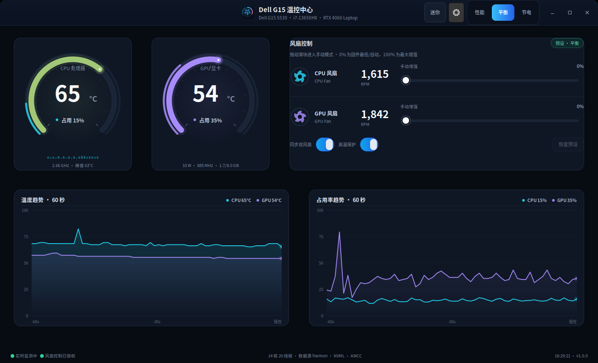
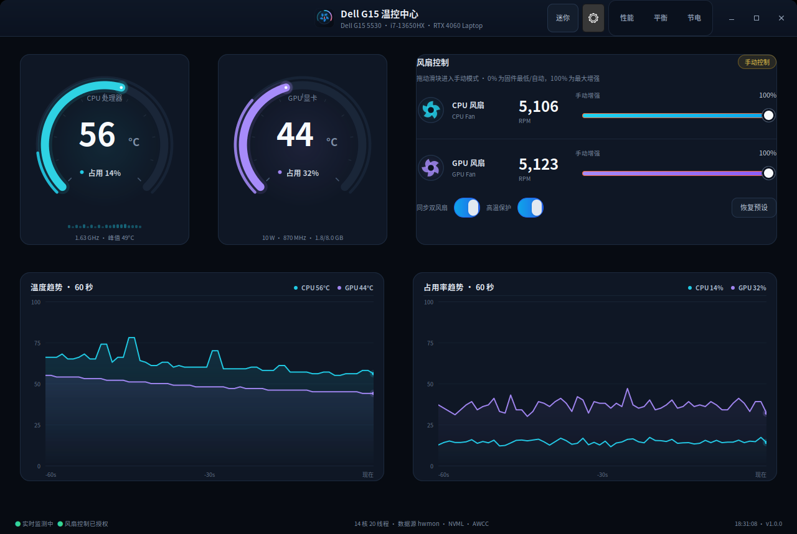
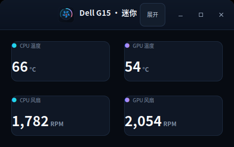

# Dell G15 温控中心

为 **Dell G15 5530（i7-13650HX + RTX 4060 Laptop）** 在 Ubuntu 24.04 上实现的实时温控与风扇控制桌面应用。已在当前这台电脑上完成安装与实际风扇转速验证。



手动模式下可分别或同步调节两个风扇，滑块显示 AWCC 增强量，旁边是实际 RPM：



点标题栏的 **“迷你”** 按钮（或菜单“迷你模式”）后，窗口缩成只显示温度和两个风扇转速的小窗；点 **“展开”** 恢复完整界面：



## 功能

- **实时监测**
  - CPU 封装温度、最高核心温度、总体/每核心占用率、实时频率
  - GPU 温度、核心占用率、显存占用、功耗、SM 频率（NVML）
  - CPU / GPU 双风扇实际转速（RPM）
  - 60 秒温度与占用率趋势图
- **风扇手动调速**
  - 两个风扇独立滑块，或打开“同步双风扇”一起调节
  - 自动切换到 AWCC `custom` 热模式后写入 `fan1_boost` / `fan2_boost`
  - 实际 RPM、增强百分比实时回读
  - **高温保护**：手动模式下 ≥88 °C 自动提升到 80%，≥93 °C 提升到满速，回落后恢复你的设定
- **Dell 预设模式一键切换**
  - 性能（performance）/ 平衡（balanced）/ 节电（quiet）
  - 通过 `power-profiles-daemon` 切换，无需每次输入密码
  - 从手动模式点“恢复预设”会强制写回 AWCC 热模式，确保退出自定义风扇
- **迷你模式**
  - 标题栏“迷你”按钮 / 菜单“迷你模式（温度 / 风扇）”一键切换
  - 只保留 CPU、GPU 温度和两个风扇 RPM，窗口缩到约 460×290
  - 迷你窗口里点“展开”即可恢复完整界面，自动回到原来的窗口大小
  - 也支持 `--compact` 直接以迷你模式启动
- **桌面体验**
  - 深色 GTK3 仪表盘、实时曲线、风扇动画
  - 窗口可自由缩放、最大化和最小化
  - 开机自启动开关
  - 关闭窗口自动保存设置
  - 无任何 pip 依赖，使用 Ubuntu 官方 `python3-gi-cairo`

## 系统依赖

Ubuntu 24.04 桌面版通常已经自带；如果缺少：

```bash
sudo apt install -y python3-gi python3-gi-cairo python3-psutil gir1.2-gtk-3.0
```

## 快速开始

### 1. 直接运行（监控 + 预设模式）

```bash
cd dell-g15-thermal-control
./run.sh
```

这种方式可以查看全部温度和占用率，并切换性能/平衡/节电；风扇滑块会显示为锁定状态。

### 2. 安装风扇手动控制（一次性）

```bash
sudo bash install.sh
```

安装程序会：

1. 安装应用文件到 `/opt/dell-g15-thermal`
2. 安装 root 助手到 `/usr/local/libexec/dell-g15-thermal/helper.py`
3. 启用 systemd 服务 `dell-g15-thermal-helper.service`
4. 创建 `/run/dell-g15-thermal/helper.sock`（仅允许安装时指定的用户 UID 连接）
5. 添加应用菜单项和桌面快捷方式

安装后可以从应用菜单搜索 **“Dell G15”**，或运行：

```bash
/usr/local/bin/dell-g15-thermal
```

也可以在应用内点击风扇卡片下方的 **“启用风扇控制”**，通过系统授权窗口完成同样的安装。

> 助手只写入本机 sysfs（风扇增强、AWCC 热模式），监听本机 Unix 套接字，**不联网、不采集数据**。套接字本身是 0666，但服务用 `SO_PEERCRED` 校验连接进程的 UID，只有安装时记录的用户（以及 root）可以控制风扇。

## 使用说明

- 顶部 **性能 / 平衡 / 节电** 按钮对应 Dell G15 原厂三种模式。
- 拖动任一风扇滑块即进入 **手动控制**，应用会把 AWCC 热模式切到 `custom`，然后写入增强值。
- 进入手动模式后，顶部三个预设按钮都会取消高亮，风扇卡片右上角显示 **“手动控制”**；点“恢复预设”退出。
- 滑块表示 **AWCC 风扇增强量**（0–100%，对应固件 0–255），不是绝对 RPM：
  - 实际 RPM 还会受到固件温度曲线影响；
  - 在高温下，固件仍可能强制保持较高转速，这是 Dell EC 的安全策略；
  - 0% 不等于停转，通常表示固件最低/自动曲线。
- “同步双风扇”打开时，拖动一个滑块会同时设置两个风扇。
- “恢复预设”会回到你上一次选择的性能/平衡/节电模式，并让固件恢复自动风扇曲线。
- 关闭“高温保护”后，手动设定在高温下也不会被应用自动干预（不建议）。
- **关闭应用不会自动改回预设**：风扇会保持最后一次手动增强，固件自身的温度保护仍然生效。要恢复 Dell 自动风扇曲线，请点“恢复预设”或切换任意预设模式。

## 已验证的硬件/接口

| 项目 | 本机结果 |
| --- | --- |
| 机型 | Dell G15 5530（`/sys/class/dmi/id/product_name`） |
| CPU | 13th Gen Intel Core i7-13650HX，14 核 20 线程 |
| GPU | NVIDIA GeForce RTX 4060 Laptop GPU（8 GB） |
| 系统 | Ubuntu 24.04.5 LTS，内核 7.0.0-38-generic，GNOME X11 |
| CPU 温度 | `coretemp` hwmon（Package id 0） |
| GPU 温度/占用 | NVML `libnvidia-ml.so`（回退 `nvidia-smi` / hwmon） |
| 风扇 | `alienware_wmi` hwmon：`fan1_input`、`fan2_input` |
| 风扇控制 | `alienware_wmi` hwmon：`fan1_boost`、`fan2_boost`（0–255） |
| 预设模式 | `alienware-wmi` platform-profile + `power-profiles-daemon` |

实际测试中，手动增强从 32 提升到 255 时，两个风扇从约 3900 RPM 上升到约 4900 RPM，随后成功恢复到性能预设。

## 当前安装状态自查

```bash
systemctl is-active dell-g15-thermal-helper   # 应输出 active
ls -l /run/dell-g15-thermal/helper.sock       # 应存在
powerprofilesctl get                          # 当前 Dell 预设
grep -l alienware_wmi /sys/class/hwmon/hwmon*/name
```

## 常见问题

**看不到风扇转速 / 没有 `alienware_wmi`**

```bash
lsmod | grep alienware
grep -l alienware_wmi /sys/class/hwmon/hwmon*/name
sudo modprobe alienware_wmi
```

若仍然没有，请确认内核版本支持 AWCC 风扇增强（Linux 6.15+ 的 `alienware-wmi` 驱动），或重启后再试。

**GPU 占用率显示 `--`**

应用优先使用 NVML；如果 NVML 初始化失败（例如驱动版本不匹配、设备权限受限），会回退到 `nvidia-smi`，再回退到 hwmon 温度。此时温度仍可显示，但占用率不可用。可用下面命令排查：

```bash
nvidia-smi
python3 -c "import ctypes; ctypes.CDLL('libnvidia-ml.so.1').nvmlInit_v2()"
```

**风扇滑块是灰色的**

说明 root 助手没有安装或当前用户不在允许列表。点击“启用风扇控制”重新安装，或检查：

```bash
systemctl status dell-g15-thermal-helper
journalctl -u dell-g15-thermal-helper -n 50
cat /etc/dell-g15-thermal.conf
```

**切换模式失败**

```bash
powerprofilesctl get
powerprofilesctl set balanced
```

如果系统没有 `power-profiles-daemon`，应用会尝试通过助手直接写 AWCC 热模式。

**卸载**

```bash
sudo bash /opt/dell-g15-thermal/uninstall.sh
```

用户设置保留在 `~/.config/dell-g15-thermal/settings.json`，可手动删除。

## 项目结构

```
dell_g15_thermal/
  app.py          GTK3 主窗口、采样循环、交互
  sensors.py      hwmon / coretemp / NVML 传感器层
  control.py      助手客户端、PPD 预设切换、设置存储
  widgets.py      Cairo DrawingArea 仪表盘、趋势图、风扇卡片、迷你视图
  helper.py       root 助手（Unix 套接字，systemd）
  theme.css       深色主题
  assets/icon.svg 应用图标
install.sh        一次性安装脚本
uninstall.sh      卸载脚本
run.sh            免安装启动器
```

## 窗口尺寸与迷你模式

- 完整窗口最小约 1180×727（含窗口边框），可以自由拖动缩放、最大化或最小化（标题栏按钮 / 菜单均可）。
- 标题栏 **“迷你”** 按钮或菜单 **“迷你模式（温度 / 风扇）”** 进入迷你窗口：
  - 只显示 CPU 温度、GPU 温度、CPU 风扇 RPM、GPU 风扇 RPM；
  - 窗口缩小到约 460×290，仍会每秒刷新；
  - 点标题栏 **“展开”** 或菜单中的迷你模式项即可恢复完整界面。
- 命令行也可直接以迷你模式启动：

```bash
/usr/local/bin/dell-g15-thermal --compact
```

- 进入迷你模式前的完整窗口大小会被记住，展开时恢复；关闭应用时保存的是完整窗口大小，不会因为曾在迷你模式而下次启动变小。

## 安全说明

- 应用不会自动改风扇，除非你拖动滑块；切换预设时由 Dell 固件恢复自动曲线。
- 手动模式下的高温保护默认开启，但固件本身始终保留温度保护。
- root 助手只接受固定操作（设置增强值、切换 AWCC 热模式），参数会被限制在 0–255 和固件支持的模式列表内。
- 写入 WMI/EC 的间隔被限制为 ≥120 ms，避免高频刷新冲击嵌入式控制器。

## 许可

MIT License。可自由修改和分发。
